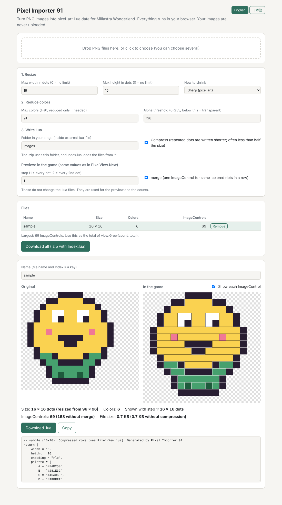
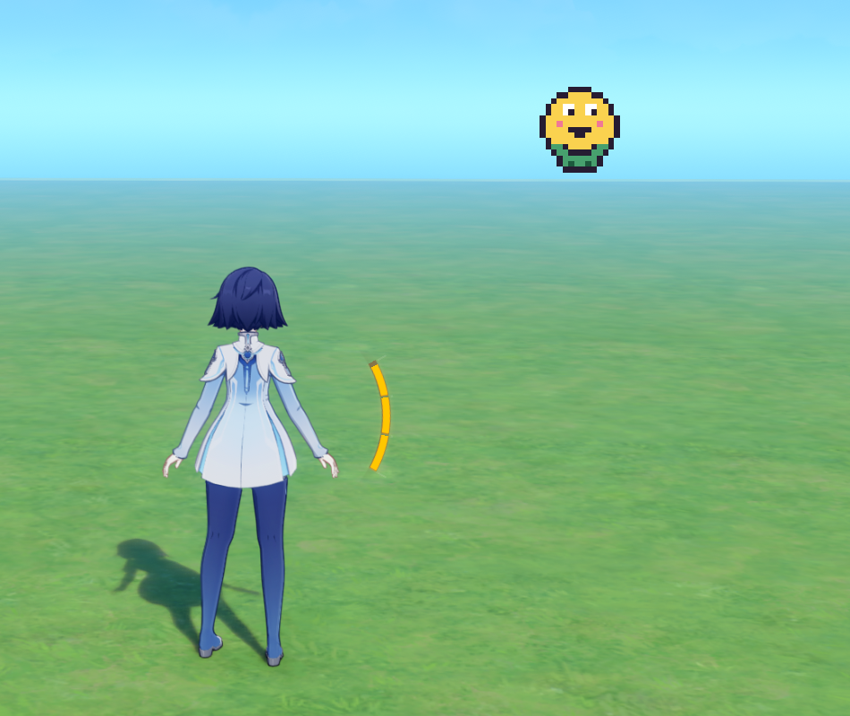

# Pixel Importer 91

**星々の幻境（Miliastra Wonderland）**で、クライアントスクリプト（Lua）を使って好きな画像を表示するためのツールです。

Pixel Importer 91 は、連携して動作する**2つのコンポーネント**から構成されています。

1. **ブラウザ上で動作するコンバーター（`index.html`）**：1枚または複数のPNG画像をリサイズし、コンパクトなLuaデータファイルに変換します。変換した画像を読み込むための `Index.lua` も自動生成します。処理はすべてブラウザ内で完結します。
2. **Luaレンダラー（`lua/PixelView.lua`）**：ステージのクライアントスクリプトから使用するライブラリです。変換した画像をImageControlを使って表示し、画像データのデコード、隣接するピクセルの結合、ImageControlの再利用を行います。

つまり、**コンバーターが画像データを準備し、Luaレンダラーがゲーム内に表示する**という仕組みです。ピクセルアート、アイコン、イラスト、写真などに対応しています。

**[コンバーターを開く](https://hiro400.github.io/pixel-importer-91/)** · **[解説動画を見る](https://youtu.be/Akh2coZszas)** · **[English README](README.md)**

## デモと解説動画





*ゲーム内の表示例：16 × 16ドットの画像を69個のImageControlで描画。*

**初めて使用する場合は、[解説動画](https://youtu.be/Akh2coZszas)をご覧ください。** 画像の変換、ImageControlテンプレートの準備、Script MappingへのLuaファイルの登録、エディタ内での表示方法を説明しています。

このREADMEは主に、**コンバーターの機能、Lua API、性能に関する注意点、データ形式を参照するための資料**です。エディタでの導入手順については、動画と同じ説明を繰り返していません。

## なぜ Pixel Importer 91 なのか？

既存のUI画像表示ツールでは、生成されるファイルが大きくなりがちで、1つの星々の幻境のステージに多数の画像を組み込むことが難しくなります。Pixel Importer 91 は、**各画像を91色に制限する代わりに、画像データを非常にコンパクトな形式で保存する**ことで、この問題を解決します。

主な特徴は次のとおりです。

- **コンパクトなLuaデータ。** PNG画像をLuaファイルに変換し、色情報を1ピクセルあたり約1バイトで記録します。さらに91色という制約を利用し、Run-Length Encoding（RLE）に似た符号化方式でデータを圧縮します。
- **ImageControl数の削減。** 同じ色のピクセルが水平方向に連続している場合、1つの横長のImageControlにまとめられます（**Merge**。デフォルトで有効）。
- **効率的な描画。** 生成済みのImageControlを可能な限り再利用します。また、`Grow` 関数を使えばImageControlを複数フレームに分けて徐々に生成でき、初回描画時のフリーズを軽減できます。
- **複数画像の一括変換。** 複数のPNG画像をまとめて変換し、自動生成される `Index.lua` で管理できます。
- **ローカルでの変換。** コンバーターはブラウザ内だけで動作するため、インストールや画像のアップロードは不要です。
- **柔軟な設定。** 画像の解像度、リサイズ方法、透明度のしきい値、ピクセルの結合、表示時の解像度を調整できます。

## PixelView API

### 最小限の使用例

以下は、動画で説明しているエディタ側の準備が済んだ後に使用するコード例です。

```lua
local PixelView = require("pixel_importer/PixelView")
local Images = require("images/Index")

local view = PixelView.New({
    parent = script.object,
    templateIndex = 1, -- 使用するImageControlテンプレートのインデックスに変更する
    x = 200,
    y = 200,
    dotSize = 4,
})

view:Show(Images["sample"])
```

この例では、コンバーターの **置き場所のフォルダ**（Folder in your stage）を `images` に設定し、生成されたファイルを `external_lua_file/images` に、`PixelView.lua` を `external_lua_file/pixel_importer` に配置します。この場合、読み込みパスは `images/Index` と `pixel_importer/PixelView` です。異なるフォルダを使う場合は `require` のパスも変更してください。また、`script.object` が適切なUI親要素であり、ImageControlテンプレートが作成済みであることを前提としています。**大きな画像**では、後述のように `Show` を呼び出す前に `Grow` でImageControlを事前生成してください。より詳しい例は [`examples/Main.lua`](examples/Main.lua) を参照してください。

### メソッド

| メソッド | 説明 |
| --- | --- |
| `PixelView.New(options)` | Viewを作成します。オプションは下表を参照してください。 |
| `view:Show(art)` | 画像を表示します。同じ画像がすでに表示されている場合は何もしません。`nil` を渡すと非表示になります。 |
| `view:Clear()` | 表示中の画像を非表示にします。ImageControlは破棄されず、後で再利用できます。 |
| `view:Count(art)` | 現在のView設定で必要なImageControl数を返し、後で表示するための画像の配置も事前計算します。`nil` に対しては `0` を返します。 |
| `view:Prepare(art)` | 画像を表示せずに配置を事前計算します。通常、`Count` を使用していれば不要です。 |
| `view:Grow(count, total)` | View内のImageControlが合計 `total` 個になるまで、1回の呼び出しにつき最大 `count` 個を追加生成します。目標数に達すると `true` を返します。 |

通常、`Show` は画像を初めて表示する際に、必要なImageControlの位置と色を計算します。`Count` または `Prepare` を先に呼び出すと、その計算を事前に済ませられるため、初回の `Show` の処理を軽くできます。

大きな画像では、`Grow` が `true` を返すまで、**毎フレーム1回**（たとえば `OnUpdate` 内で）呼び出してください。

```lua
local art = Images["sample"]
local total = view:Count(art)

-- OnUpdate内で、trueが返るまで繰り返す：
if view:Grow(300, total) then
    view:Show(art)
end
```

第1引数を小さくすると、1フレームで生成するImageControl数が減り、準備中のカクつきを抑えられる場合があります。上記はAPIの使用パターンを示すものであり、イベントハンドラーを含む完全なスクリプトではありません。

### `PixelView.New` のオプション

| オプション | デフォルト値 | 説明 |
| --- | --- | --- |
| `parent` | 必須 | ImageControlを作成するUI親要素。 |
| `templateIndex` | 必須 | ImageControlテンプレートのインデックス。 |
| `x`, `y` | `0`, `0` | 左上のドットの位置（`anchoredPositionX` / `Y`）。 |
| `dotSize` | `4` | 各ドットの大きさ、および隣接するドット位置の間隔。 |
| `step` | `1` | 元画像の各方向について `step` 個ごとにドットを表示します。たとえば `2` にすると、表示上の幅と高さがそれぞれおよそ半分になります。 |
| `merge` | `true` | 各行で隣接する同色のドットを結合し、横長のImageControlにします。 |
| `gap` | `0` | 隣接するドット間の隙間。`dotSize` より小さい値にする必要があります。 |
| `pivotX` | `0.5` | ImageControlテンプレートの水平方向のピボット（`0` = 左、`0.5` = 中央、`1` = 右）。`merge` が有効な場合に使用します。 |

### 画像を読み込めない場合

生成された画像ファイルを読み込めない場合（たとえばScript Mappingに登録されていない場合）、`Index.lua` は次のようなメッセージを出力します。

```text
[Pixel Importer 91] Cannot load: sample
```

その画像は `nil` として扱われます。`view:Show(nil)` は現在の画像を非表示にし、`view:Count(nil)` は `0` を返します。

## 設定の選び方

### コンバーター側の設定

- **横・縦のドット数の上限**（Max width / Max height）： アスペクト比を維持しながら、出力画像の最大ドット数（幅・高さ）を制限します。指定範囲に収まる画像は拡大されません。
- **なめらか／くっきり**（Smooth / Sharp）： イラストや写真にはSmooth（バイキュービック補間）、元のピクセルの輪郭を保ちたいピクセルアートにはSharp（最近傍補間）が適しています。
- **透明の基準**（Alpha threshold）： 変換後の各ドットを不透明と透明のどちらにするかを決めます。半透明は保持されません。
- **圧縮する**（Compress、デフォルト：オン）： 書き出すLuaデータにRLE圧縮を適用します。ファイルサイズには影響しますが、表示に使用するImageControl数には影響しません。
- **merge**（デフォルト：オン）：描画時に水平方向に連続する同色のドットを結合し、ImageControl数を削減します。描画方法には影響しますが、91色のパレット自体は変えません。

コンバーターでは、変換結果のプレビュー、画像ごとのImageControl数、バッチ内で最大のImageControl数も確認できます。
コンバーターのプレビュー欄にある **step** と **merge** は、このプレビューと数の表示だけを変え、生成されるファイルには影響しません。
ゲームと数が一致するよう、`PixelView.New` と同じ値にしてください。

### Luaでの描画時の設定

**`Grow`** は、複数フレームに分けてImageControlを事前生成するための関数です。数千個のImageControlを一度に生成すると、目立つ停止が発生することがあります。`view:Count(art)` で必要数を調べ、`Show` の前に `Grow` を繰り返し呼び出してください。生成中にカクつく場合は、1フレームあたりの `count` を小さくします。

**`step`** を使うと、画像を再変換せずに、同じ画像データから低解像度で表示できます。`step = 2` の場合、結合処理を行う前の段階で、元のドットのおよそ4分の1がサンプリングされるため、必要なImageControl数が大きく減る場合があります。

**`merge` と `gap`** は互いに影響します。結合された横長のImageControlは、元のドット間にあった隙間も含めて描画します。各ドット間の隙間を見せたい場合は、`merge = false` を使用してください。

**可能な限りViewを再利用してください。** 各Viewはそれぞれ独自のImageControlを管理します。同じ場所に異なるタイミングで表示する画像は、1つのViewを共有できます。`Clear` は後で再利用できるImageControlを削除せずに画像を非表示にします。

## 性能

重要な最適化は2種類あります。

| 最適化 | 削減するもの | 必ずしも削減しないもの |
| --- | --- | --- |
| **Compress（RLE）** | 生成されるLua画像データのサイズ | ImageControl数 |
| **Merge** | ImageControl数と、画像表示に必要な処理 | Lua画像データのサイズ（生成されるファイルは同じ） |

### ImageControl数と表示時間

不透明な128 × 144ドットの画像には、**18,432個のドット**があります。結合しない場合、18,432個のImageControlが必要です。128 × 144ドットの人物画像を使った1回の測定では、次の結果になりました。

| 測定項目 | Mergeオフ | Mergeオン |
| --- | ---: | ---: |
| ImageControl数 | 18,432 | 8,607 |
| `Show` の実行時間 | 約0.32秒 | 約0.16秒 |

これは**特定の1枚の画像による測定結果**であり、常に同じ性能が得られるという保証ではありません。Mergeは同色のピクセルが水平方向に長く続く画像で特に効果的です。細部の多い画像では効果が小さくなる場合があります。

### Luaデータのサイズ

圧縮を有効にすると、同じドットの繰り返しや、直前の行と同じパターンの繰り返しを短いコードで表現します。圧縮率は画像によって異なり、一般に単色の領域や繰り返しの多い画像の方が、色の変化が激しい画像よりもよく圧縮されます。

比較する際は、実際に使用する画像について、Compressのオン・オフそれぞれで**生成された `.lua` ファイルのサイズ**を確認してください。上記のImageControl数と表示時間の測定値から、一般的な圧縮率を推定することはできません。

## データ形式

圧縮していない画像データは、次の形式で生成されます。

```lua
return {
    width = 16,
    height = 16,
    palette = {
        A = "#FAD250",
        B = "#281E32",
        ["7"] = "#46A06E",
    },
    rows = {
        "......BBBB......",
        "....BBAAAABB....",
        -- ...
    },
}
```

`rows` 内の各文字は1つのドットを表します。`.` は透明を意味し、それ以外の文字は `palette` 内の色を参照します。パレットは画像ごとに独立しています。

**Compress** が有効な場合、ファイルには `encoding = "rle"` も含まれます。この場合、各行は次のコードで表現されます。

| コード | 意味 |
| --- | --- |
| 色を表すキー、または `.` | 1つのドットをそのまま記録 |
| 半角スペース + 長さ + キー | `key` に対応するドットを `length` 個繰り返す |
| 半角スペース2つ + 長さ | 直前の行の同じ位置から `length` 個のドットをコピーする |

繰り返しの長さは1文字で符号化されます。符号化キーの順序に従って `A` = 4、`B` = 5、…、`.` = 95 となります。たとえば `" CA"` は `A` のドット6個を表します。繰り返しの符号化は長さ4から使用されます。3文字のコードでは、それより短い繰り返しを圧縮できないためです。

非圧縮の行にはスペースが含まれないので、通常の色キーと混同することなく、スペースをRLEコマンドの識別に使用できます。

## 仕組み

1. **リサイズ。** コンバーターは、アスペクト比を変えずに指定された最大幅・最大高さに収まるよう画像を縮小します。Smoothモードではバイキュービック補間により元画像の情報を組み合わせます。この際、透明部分の境界に暗い縁が生じにくいよう、リサイズ中は各色チャンネルにアルファ値を掛けて処理します。Sharpモードでは最近傍補間を使用し、元のピクセルの色を保持します。
2. **減色。** 91色を超える画像は、**CIE Lab**色空間でのk-means法により減色されます。各色の出現頻度を重みとして用い、**k-means++** で初期クラスタを選ぶことで、出現頻度が低くても視覚的に異なる色を残しやすくしています。乱数シードを固定しているため、結果は再現可能です。
3. **Luaへの符号化。** 最も出現頻度の高い色に `A`、次に多い色に `B`、というようにキーを割り当てます。圧縮が有効な場合は、同じドットの4個以上の連続や、直前の行と一致するドットの連続を検出し、より多くのドットをまとめられる表現を選びます。
4. **描画。** `PixelView` が画像をデコードし、ImageControlを配置します。Mergeが有効な場合は、各行で連続する同色のドットを1つの横長のImageControlとして描画します。

### なぜ91色なのか？

各色を、**Lua文字列中の1文字**で表現するためです。この形式では、パレットのキーとして91種類の印字可能なASCII文字を使用し、半角スペース、`.`、`"`、`\` は予約または除外しています。特に `.` は透明を表し、半角スペースはRLEコマンドを表します。これにより、ドットごとに複数文字の識別子を使うことなく、画像データをコンパクトに保存できます。

91色の上限は**画像ごと**に適用されます。異なる画像では、それぞれ別の91色パレットを使用できます。

## 制限事項

- **画像1枚あたり最大91色。** 色数の多い画像は自動的に減色されるため、グラデーションや微妙な色の違いが変化する場合があります。
- **透明度は2値のみ。** 出力される各ドットは不透明か透明のどちらかになり、判定に使用するしきい値はコンバーターで設定します。
- **大きな画像には依然として多くのUIコントロールが必要。** Merge、Grow、`step` は負荷の軽減に役立ちますが、ゲームの実用上の性能制約がなくなるわけではありません。
- **Mergeはドット間の隙間の見た目に影響。** `gap > 0` の場合、水平方向に結合された部分ではドット間の隙間が埋まります。

## プライバシーと安全性

コンバーターは外部ライブラリを使用しない単一のHTMLファイルです。Content Security Policy（CSP）でネットワークアクセスを制限しているため、画像はアップロードされず、ローカルで処理されます。`index.html` を保存すればオフラインでも使用できます。

## 免責事項

このツールは非公式のファンメイドツールであり、HoYoverseとは提携しておらず、同社による承認も受けていません。星々の幻境（Miliastra Wonderland）の商標は、それぞれの権利者に帰属します。

## ライセンス

[MIT](LICENSE)
