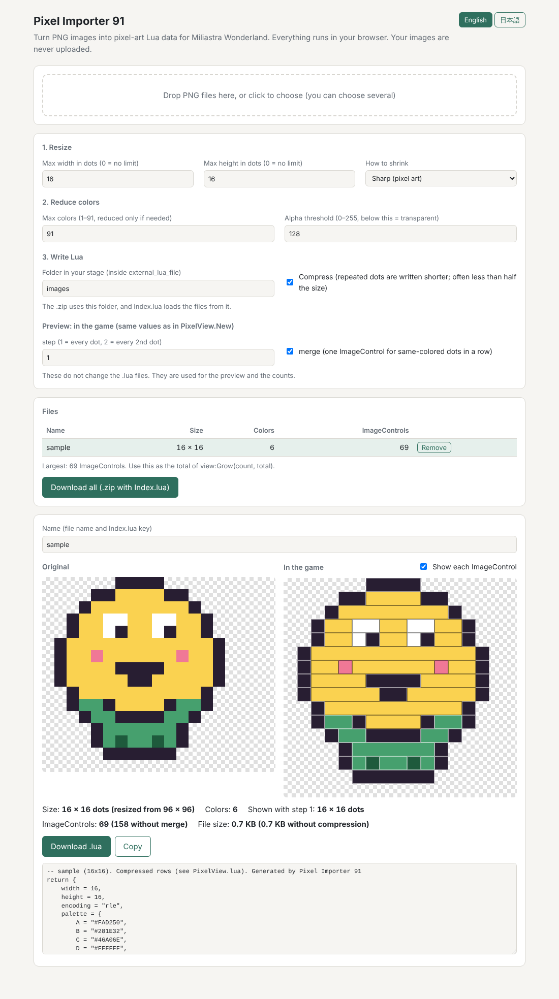
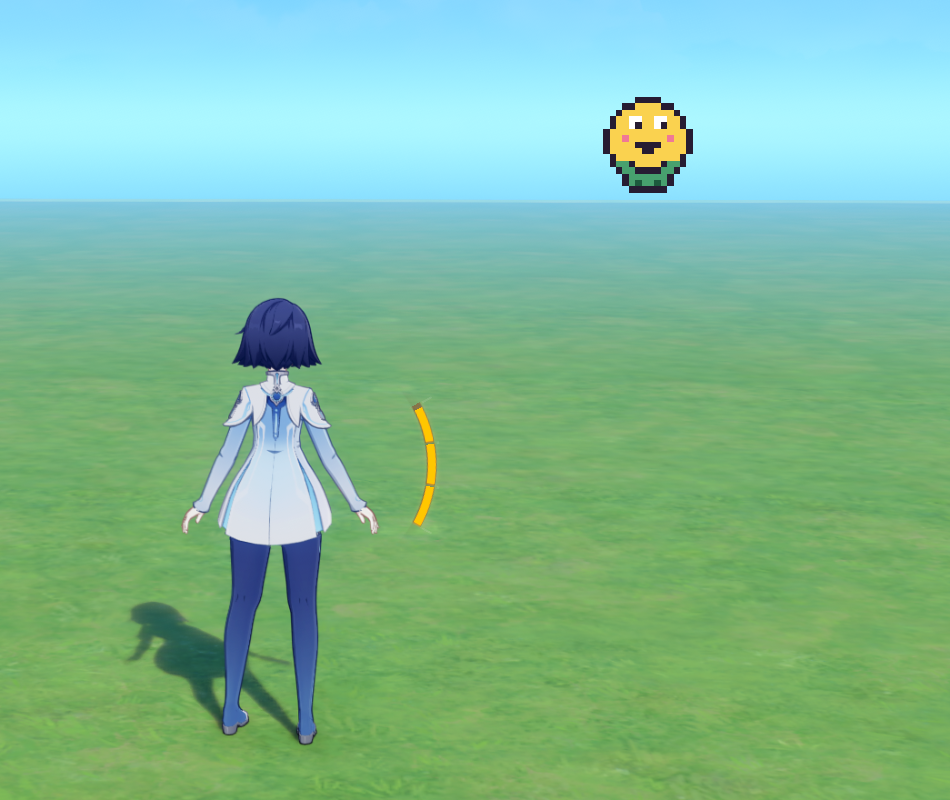

# Pixel Importer 91

Bring your own images into **Miliastra Wonderland** as pixel art, with Client Scripts (Lua).
Pixel art, icons, illustrations and photos all work: large images are shrunk to the size you choose.

Pixel Importer 91 has two parts:

1. **A converter that runs in your browser** (`index.html`). Drop PNG files on it and get Lua data files.
   No installation. Your images never leave your computer.
2. **A small Lua library** (`lua/PixelView.lua`). It draws the picture in the game by placing square ImageControls.

**Why 91?** Each color is written as one character in a Lua string, and exactly 91 printable ASCII characters
are safe to use that way. So a picture can have up to 91 colors, and the data stays short and easy to read.

[日本語の説明はこちら (README.ja.md)](README.ja.md)

**Open the converter:** [https://hiro400.github.io/pixel-importer-91/](https://hiro400.github.io/pixel-importer-91/)





*The sample picture in the game (16 × 16 dots, 69 ImageControls).*

## Features

- Works in three steps: **resize → reduce colors → write Lua**, and the settings are in the same order.
- Shrinks large images to fit a maximum width and height in dots, keeping their shape.
  Choose **smooth** (bicubic) for illustrations and photos, or **sharp** (nearest) for pixel art.
- Reduces the colors to 91 or fewer when needed, keeping small but important colors such as eye colors.
- Converts many files at once and makes `Index.lua`, so all pictures can be loaded with one `require`.
- Shows how the picture will look in the game, and how many ImageControls it needs.
- **Merging** (on by default): same-colored dots next to each other in a row share one ImageControl.
  This often cuts the number of ImageControls, and the time to show a picture, by about half.
- **Compression** (on by default): repeated dots are written shorter, so the `.lua` files are often less than half the size.
  PixelView expands them by itself.
- `Grow`: creates the ImageControls a few at a time before they are needed, so showing the first picture does not freeze the game.
- `step`: shows a picture at half (or lower) resolution without converting it again.

## Quick start

### 1. Convert your pictures

1. Open the converter and drop one or more PNG files on it.
   Each pixel of the image becomes one dot, so set **Max width** and **Max height** for large images
   (for example 128 × 144).
   For pixel art saved larger than its real size (a 16×16 picture saved as 96×96), choose **Sharp**
   and set the limits to the real size (16 × 16). You get exactly the original dots back.
2. Set **Folder in your stage** to the folder you will use inside `external_lua_file` (for example `mygame/images`).
   The .zip uses this folder, and Index.lua loads the files from it.
3. Click **Download all**. You get a `.zip` file with one `.lua` per picture and an `Index.lua`.

### 2. Put the files in your stage

1. Unzip the file into the `external_lua_file` folder of your stage, so the folders match the require path.
2. Copy `lua/PixelView.lua` into a folder named `pixel_importer` inside `external_lua_file`
   (a folder of its own keeps it from clashing with your other files).
3. Register each `.lua` file (`PixelView.lua`, `Index.lua`, your pictures and your own script) in Script Mapping.

### 3. Make a template

Make one **ImageControl** in the UI editor and save it as a template. Its size does not matter:
PixelView resizes each ImageControl to the size of one dot (`dotSize`, below).
Leave its pivot in the center.

### 4. Show the picture

```lua
local PixelView = require("pixel_importer/PixelView")
local Images = require("mygame/images/Index")

local view = PixelView.New({
    parent = script.object.parent,
    templateIndex = 1,   -- your ImageControl template
    x = 800,
    y = 450,
    dotSize = 4,
})

view:Show(Images["sample"])
```

See [`examples/Main.lua`](examples/Main.lua) for a complete script that uses `Grow`.

## PixelView reference

| Function | What it does |
| --- | --- |
| `PixelView.New(options)` | Makes a view. See the options below. |
| `view:Show(art)` | Shows a picture. Does nothing if the same picture is already shown. `nil` hides it. |
| `view:Clear()` | Hides the picture. |
| `view:Count(art)` | How many ImageControls the picture needs with this view's settings. It also does the picture's calculation in advance (see below). |
| `view:Grow(count, total)` | Creates up to `count` ImageControls now, until there are `total`. Returns `true` when done. |

The first `Show` of a picture works out where each ImageControl goes, and remembers the result.
`Count` does this calculation too, so after `Count` the first `Show` is already faster.
To do only the calculation, there is also `view:Prepare(art)`. Usually you do not need it.

**When a picture cannot be loaded** (for example, it is not registered in Script Mapping), the game does not stop.
`Index.lua` prints `[Pixel Importer 91] Cannot load: name` once when it is loaded, and that picture becomes `nil`.
`view:Show(nil)` just hides the picture, and `view:Count(nil)` returns 0.

Options of `PixelView.New`:

| Option | Default | Meaning |
| --- | --- | --- |
| `parent` | (required) | Where the ImageControls are created. |
| `templateIndex` | (required) | The ImageControl template (any size). |
| `x`, `y` | `0`, `0` | Position of the top-left dot (`anchoredPositionX` / `Y`). |
| `dotSize` | `4` | Size of one dot. Dots are placed this far apart. |
| `step` | `1` | `2` uses every 2nd dot: half the width and height, a quarter of the ImageControls. |
| `merge` | `true` | Same-colored dots next to each other in a row share one wide ImageControl. `false` turns it off. |
| `gap` | `0` | Space left between neighboring dots. Must be smaller than `dotSize`. |
| `pivotX` | `0.5` | The template's horizontal pivot (0 = left, 0.5 = center, 1 = right). Only used with `merge`. |

## Choosing the settings

**How many ImageControls?** Without merging, each visible dot needs one ImageControl:
a 128×144 picture with no transparent dots needs 18,432. Merging (the default) needs far fewer.
The converter shows the number for each picture, and the largest one.

**`Grow`.** Creating thousands of ImageControls at once takes time. Call `Grow` once per frame
(for example in `OnUpdate`) with the largest number from the converter as `total`.
After that, `Show` only moves and colors ImageControls that already exist.
If the game stutters while growing, use a smaller `count`.

**`merge`.** In a test with a 128×144 portrait, merging cut the ImageControls from 18,432 to 8,607,
and the time of `Show` from about 0.32 s to 0.16 s.
A wide ImageControl also covers the gaps between its dots.
With a `gap`, `merge` fills the gaps inside each merged piece and changes the look.
With the default (`gap = 0`), the look does not change.

**One view per place.** Each view creates its own ImageControls.
If two screens are never shown at the same time, they can share one view.

## The data format

```lua
return {
    width = 16,
    height = 16,
    palette = {
        A = "#FAD250",
        B = "#281E32",
        ["7"] = "#46A06E",
    },
    rows = {
        "......BBBB......",
        "....BBAAAABB....",
        -- ...
    },
}
```

Each character in `rows` is one dot. `"."` is transparent, and other characters are looked up in `palette`.

With **Compress** (the default), the file also has `encoding = "rle"`, and each row is written like this:

| In the row | Means |
| --- | --- |
| a color key or `.` | one dot, as it is |
| space + length + key | the key repeated *length* times |
| two spaces + length | the same *length* dots as in the row above |

A length is one character: `A` = 4, `B` = 5, ... in the order of the color keys, then `.` = 95.
For example, `" CA"` is `A` six times. Spaces never appear in uncompressed rows, so there is no mix-up,
and all 91 colors can still be used.

## Limits

- **At most 91 colors per picture.** Each color is one character, and only 91 printable ASCII characters
  are safe in a Lua string (`.`, `"`, `\` and space are not used). Pictures with more colors are reduced automatically.
- **No half transparency.** A dot is either drawn or transparent (set the threshold in the converter).
- **Large pictures need many ImageControls.** Keep merging on, and use `Grow` (and `step` if needed).

## How it works

1. **Resize.** If the image is larger than the limits, it is shrunk to the largest size that fits and keeps its shape.
   Smooth shrinking uses a bicubic filter, stretched so that every pixel of the image is mixed in.
   Colors are multiplied by alpha while resizing, so transparent pixels do not darken the edges.
   Sharp shrinking takes the pixel nearest to the center of each new dot, so no new colors are made.
   Images that already fit are never enlarged.
2. **Colors.** If there are too many colors, they are grouped with k-means in the CIE Lab color space,
   where distance is close to how different colors look. Each color is weighted by how many dots use it,
   and the starting groups are chosen with k-means++, which spreads them out so that rare but distinct colors survive.
   A fixed random seed makes the result the same every time.
3. **Lua.** The most used color gets `A`, the next `B`, and so on.
   With compression, each row is read from left to right: a run of 4 or more of the same dot, or 4 or more dots
   that match the row above, is written as a 3-character code (whichever covers more dots).

## Safety

The converter is one HTML file with no external libraries. Its `Content-Security-Policy` line tells the browser
that the page may not load or send anything over the network, so your images stay on your computer.
You can also save `index.html` and use it offline.

## Note

This is an unofficial, fan-made tool. It is not affiliated with or endorsed by HoYoverse.
Miliastra Wonderland is a trademark of its owner.

## License

[MIT](LICENSE)
